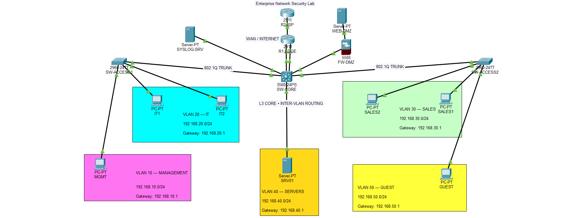
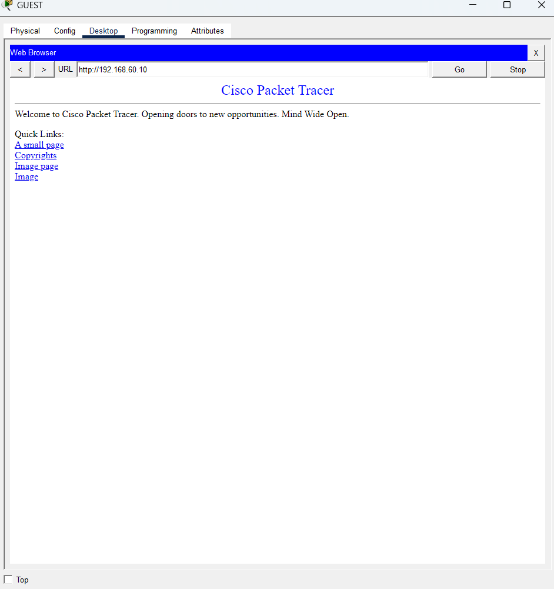
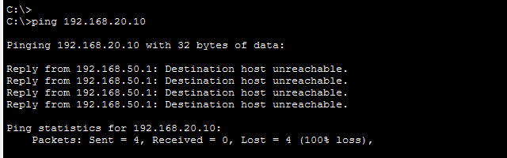
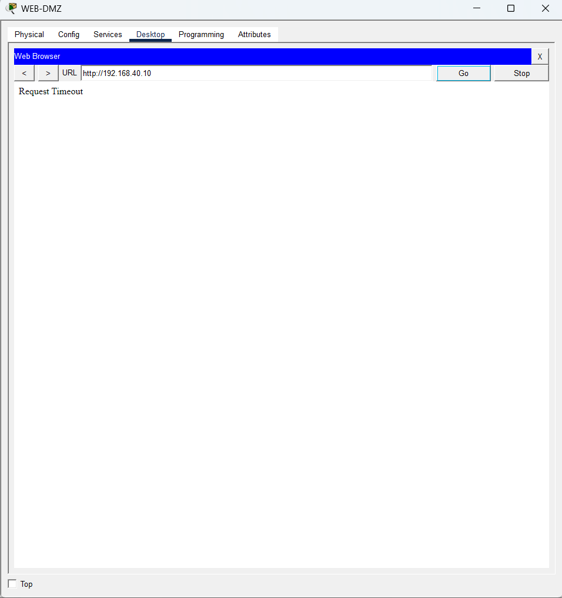
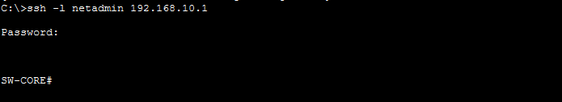
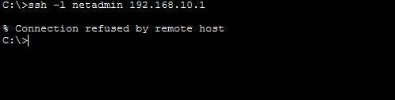
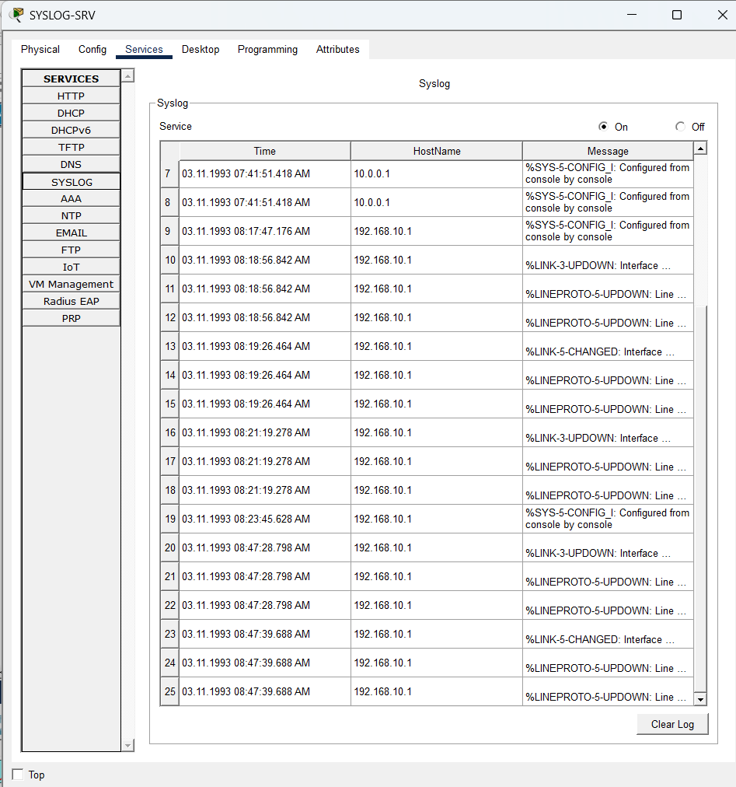
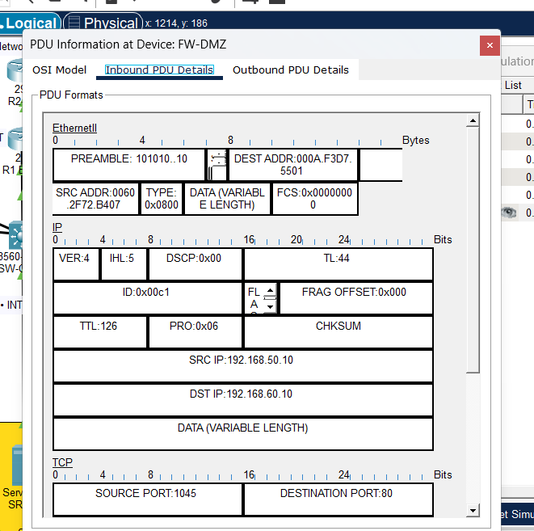
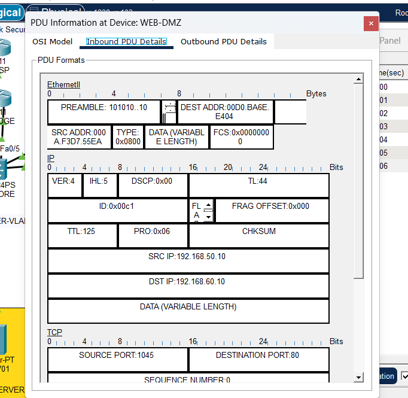

# Enterprise Network Security Lab

**Author:** Haim Yalow  
**Platform:** Cisco Packet Tracer  
**Validation date:** 17 November 2026

A simulated enterprise network demonstrating segmentation, inter-VLAN routing, a firewall-protected DMZ, restricted management access, and centralized logging. This is an educational lab, not a production deployment.

## Topology

- SW-CORE: Cisco 3560 multilayer switch providing internal routing.
- SW-ACCESS1 / SW-ACCESS2: Cisco 2960 access switches connected using 802.1Q trunks.
- R1-EDGE / R2-ISP: enterprise edge and simulated upstream ISP.
- FW-DMZ: ASA 5505 between the core and WEB-DMZ.
- SYSLOG-SRV: centralized log collection.
- Endpoints: MGMT, IT1/IT2, SALES1/SALES2, GUEST, SRV01 and WEB-DMZ.

## Addressing

| Segment | VLAN | Subnet | Gateway |
|---|---|---|---|
| Management | 10 | 192.168.10.0/24 | 192.168.10.1 |
| IT | 20 | 192.168.20.0/24 | 192.168.20.1 |
| Sales | 30 | 192.168.30.0/24 | 192.168.30.1 |
| Internal servers | 40 | 192.168.40.0/24 | 192.168.40.1 |
| Guest | 50 | 192.168.50.0/24 | 192.168.50.1 |
| DMZ | 60 | 192.168.60.0/24 | 192.168.60.1 on ASA |
| Core–ASA transit | 70 | 10.0.1.0/30 | Core: 10.0.1.1; ASA: 10.0.1.2 |

Important hosts: IT1 `192.168.20.10`, SRV01 `192.168.40.10`, WEB-DMZ `192.168.60.10`, SYSLOG-SRV `192.168.10.50`. The core's edge-facing interface was observed at `10.0.0.2`.

## Security and networking configuration

The lab work included VLANs, trunks, LACP EtherChannel, inter-VLAN routing, edge NAT/PAT, guest isolation ACLs, DMZ filtering, SSHv2, management-network restrictions and shutdown of unused ports. These are documented from the lab sessions; the uploaded binary has not been independently parsed or executed for this README.

The observed ASA configuration permits inbound TCP HTTP/HTTPS to WEB-DMZ. Its DMZ-side ACL permits selected web-server reply traffic and then denies other IP traffic. This lab configuration should not be treated as a production firewall template.

## Acceptance checks

Results below were reported by the operator during the guided session and illustrated by the screenshots supplied during that session. The command-prompt crops do not show endpoint names; their source devices are based on the guided test context. They describe specific tests, not proof that every protocol or path is secure.

| Test | Observed result | Assessment |
|---|---|---|
| GUEST opens http://192.168.60.10 | Page opens | Expected |
| GUEST pings IT1, 192.168.20.10 | Ping fails | Expected; ICMP isolation check |
| WEB-DMZ opens http://192.168.40.10 | Page does not open | Expected; denial observed |
| MGMT uses SSH to 192.168.10.1 | Login succeeds | Expected |
| IT1 uses SSH to 192.168.10.1 | Connection blocked | Expected |
| SYSLOG service | On; messages from 192.168.10.1 and 10.0.0.1 | Log reception demonstrated |

The two SSH checks form one management-access acceptance check, giving five acceptance areas in total. Negative tests alone do not identify which device enforced the block. Additional Simulation Mode captures confirm the guest TCP/80 packet arriving at FW-DMZ and subsequently at WEB-DMZ.

## Known limitations

1. Ping between ASA `10.0.1.2` and core `10.0.1.1` failed in both directions. Both devices learned matching peer ARP entries. The reason remains unresolved; no verified fix is claimed.
2. ASA `show route` displayed both `10.0.0.0/30` and `10.0.1.0/30` as connected through outside/Vlan70, while the displayed Vlan70 configuration contained only `10.0.1.2 255.255.255.252`. The extra route persisted after the guided save/reload attempt. It remains unexplained; further troubleshooting was deferred.
3. Syslog timestamps show a simulated 1993 date. Log transport was demonstrated, but clock synchronization was not validated.
4. Fresh event generation and complete WAN/NAT verification were not repeated in the final acceptance session. A complete attack investigation is not claimed.

## Files and reproduction

1. Open `Enterprise_Network_Security_Lab.pkt` in a compatible Cisco Packet Tracer installation. The required version has not been established.
2. Review `screenshots/01-topology.png` and the addressing table.
3. Run the acceptance checks above and inspect SYSLOG-SRV under Services → SYSLOG.
4. Investigate the open findings before calling the lab fully resolved.

The Packet Tracer file is the operator-provided saved snapshot, included unchanged. Device startup-config persistence was requested but not independently verified. Lab credentials are intentionally omitted from this README; configurations inside the Packet Tracer file may still contain lab credentials. Use dedicated lab passwords only.

## Screenshot evidence

### Guest access to the DMZ website
GUEST opens `http://192.168.60.10` successfully.

### Guest-to-IT ICMP test
Ping to `192.168.20.10` fails with 100% loss. Gateway `192.168.50.1` returns Destination host unreachable. This is consistent with the intended isolation; this message alone does not establish the exact filtering cause.

### DMZ-to-internal HTTP test
WEB-DMZ receives Request Timeout when requesting `http://192.168.40.10`. This records the negative test result; a timeout alone does not prove a particular ACL enforced the block.

### SSH from management
The guided MGMT test reaches the `SW-CORE#` prompt using netadmin at `192.168.10.1`.

### SSH from IT
The guided IT1 test receives Connection refused by remote host for the same SSH target. Together with the successful management test this is consistent with the management restriction. ACL configuration/counters have not been captured to independently attribute the refusal.

### Centralized logging
SYSLOG-SRV is On and displays configuration and interface state messages from `10.0.0.1` and `192.168.10.1`. These are stored events; a newly generated event was not verified during this screenshot collection.

### Packet path through the ASA
Simulation Mode shows the packet arriving at FW-DMZ with source `192.168.50.10`, destination `192.168.60.10`, source TCP port `1045` and destination TCP port `80`, with TTL 126.

The same endpoint addresses and ports are then observed at WEB-DMZ, with TTL 125 and the ASA DMZ-side source MAC `000A.F3D7.55EA`. These captures demonstrate forwarding through the ASA to the web server. The earlier router event inspected during troubleshooting was an ARP reply, not the HTTP request.

